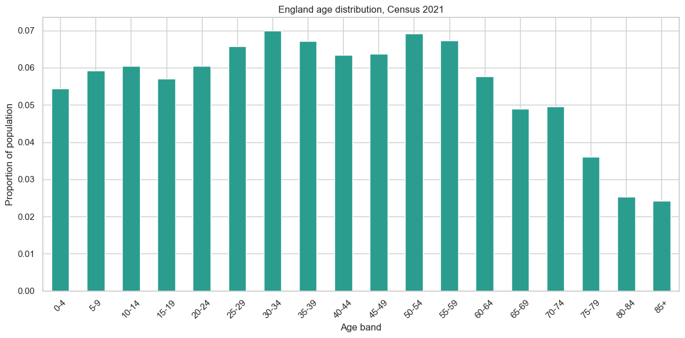
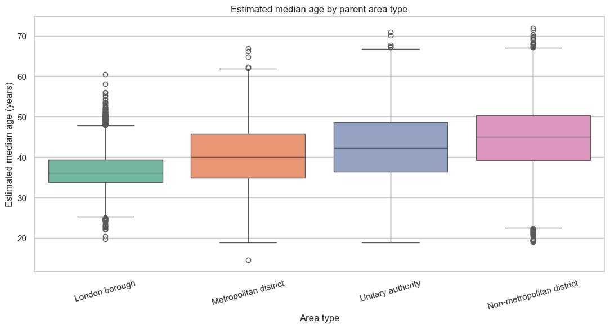
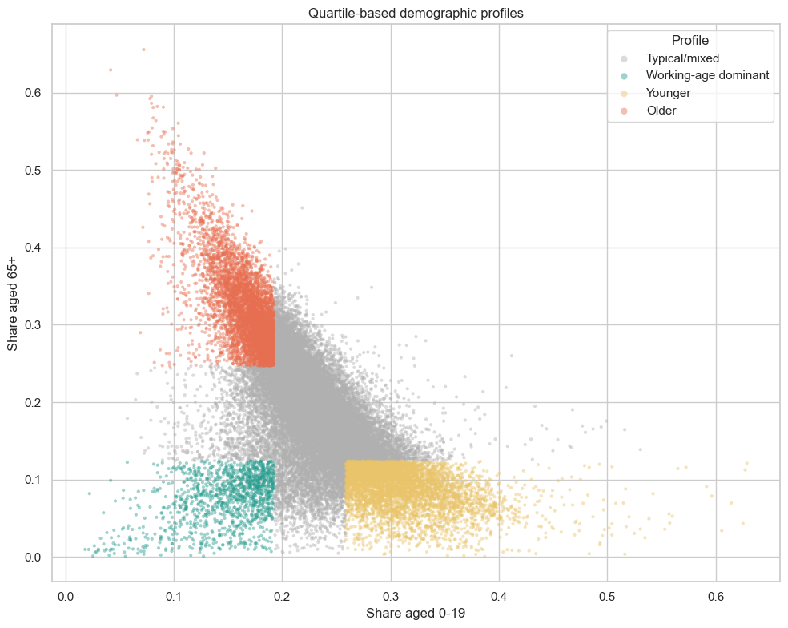

# England LSOA Demographic Analysis

An exploratory analysis of age structure across **33,755 Lower Layer Super
Output Areas (LSOAs)** in England using 2021 Census data. The project combines
population profiling, grouped-data median estimation, geographic comparison
and interpretable demographic segmentation.

## Project highlights

- Analysed **56,490,091 residents** across all 33,755 English LSOAs.
- Aggregated 18 five-year age bands into national and neighbourhood profiles.
- Estimated median age for every LSOA using interpolation within grouped age
  bands.
- Compared median-age distributions across London boroughs, metropolitan
  districts, unitary authorities and non-metropolitan districts.
- Built transparent, quartile-based rules to identify neighbourhoods with
  unusually young, older or working-age-dominant profiles.

## Questions explored

1. What does England's national age profile look like?
2. How do selected neighbourhoods differ from the national distribution?
3. How are younger and older population shares distributed across LSOAs?
4. How does estimated median age vary by broad area type?
5. Which neighbourhoods have unusually young, older or
   working-age-dominant profiles?

## Method

1. Validated the LSOA identifiers, population totals and age-band counts.
2. Aggregated neighbourhood counts into a national age distribution.
3. Converted age-band counts into comparable neighbourhood-level proportions.
4. Estimated grouped median age by locating the 50th percentile and
   interpolating within its five-year age band.
5. Derived broad area types from parent-geography codes and compared their
   distributions.
6. Classified demographic profiles using lower- and upper-quartile thresholds
   for younger and older population shares.

## Recorded findings

The 30-to-34 group is the largest individual five-year age band, representing
approximately **7.0%** of the analysed population. The three selected example
LSOAs illustrate substantial neighbourhood-level variation:



| LSOA | Younger share (0-19) | Older share (65+) | Estimated median age |
|---|---:|---:|---:|
| Bury 026E | 49.7% | 7.3% | 20.39 years |
| Birmingham 014E | 23.3% | 22.7% | 40.15 years |
| Dorset 024A | 9.1% | 54.6% | 67.67 years |

The grouped national median-age estimate is approximately **40.43 years**,
compared with **41.46 years** for the median of the 33,755 neighbourhood-level
estimates. The difference arises because the national estimate weights every
resident equally, whereas the second statistic gives every LSOA equal weight.

| Area type | Median estimated age |
|---|---:|
| London borough | 36.15 years |
| Metropolitan district | 39.97 years |
| Unitary authority | 42.28 years |
| Non-metropolitan district | 45.05 years |



Under the project's quartile-based classification, **23.7%** of London-borough
LSOAs were classified as unusually young, while **23.5%** of
non-metropolitan-district LSOAs were classified as unusually older. These are
descriptive categories defined within this dataset, not official demographic
classifications.



## Interpretation boundaries

- This is a cross-sectional description of Census 2021, not a longitudinal or
  causal analysis.
- Median ages are estimates derived from grouped counts rather than individual
  ages.
- The demographic segments depend on dataset quartiles and should be treated
  as exploratory heuristics.
- Broad area types contain different numbers of LSOAs, so percentage shares
  are more comparable than raw category counts.
- Census outputs use statistical disclosure controls, including small changes
  to some counts, which can produce minor differences between tables.

## Data source and attribution

The analysis uses **Census 2021 TS007A: Age by five-year age bands**, sourced
from the Office for National Statistics through
[Nomis](https://www.nomisweb.co.uk/datasets/c2021ts007a). The prepared analysis
file contains English LSOAs, renamed age-band columns and parent-geography
fields.

> ONS: Adapted from data from the Office for National Statistics licensed
> under the Open Government Licence v3.0.

The official bulk downloads are available from the
[Nomis Census 2021 bulk-data service](https://www.nomisweb.co.uk/census/2021/bulk).

## Run locally

```bash
python -m venv .venv
source .venv/bin/activate
pip install -r requirements.txt
jupyter lab notebooks/england_lsoa_demographic_analysis.ipynb
```

The analysis-ready dataset is already located at
`data/raw/LSOA_data.csv`.

## Repository structure

```text
england-lsoa-demographic-analysis/
├── README.md
├── data/
│   ├── ATTRIBUTION.md
│   ├── README.md
│   └── raw/LSOA_data.csv
├── notebooks/
│   └── england_lsoa_demographic_analysis.ipynb
├── results/
│   ├── README.md
│   └── generated figures
├── .gitignore
└── requirements.txt
```
